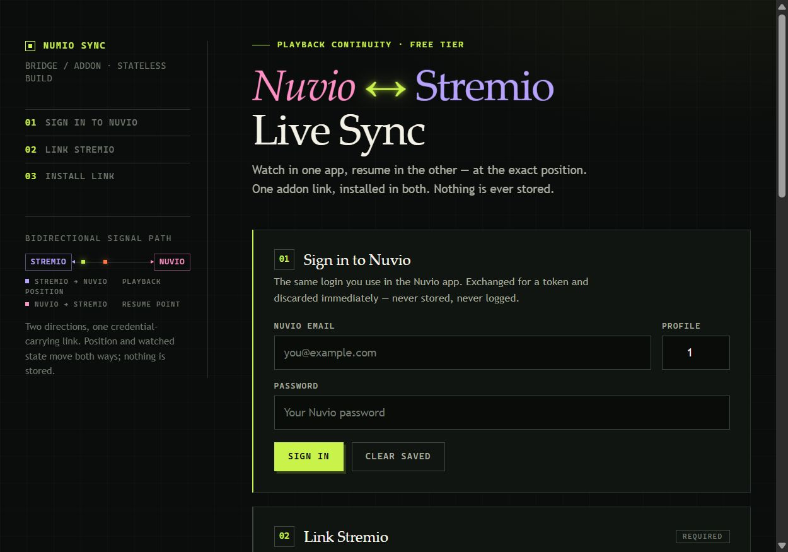
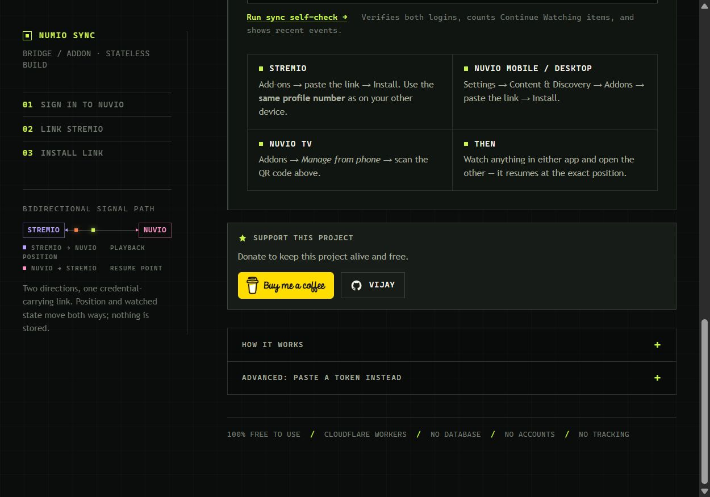

# Numio Sync

Watch a movie in one app, open the other, and continue at the exact same spot. Numio Sync keeps playback position and watched state in step between **Stremio** and **Nuvio** — in both directions.

**Use it now:** https://numio.vijay3695.workers.dev

## At a glance

| | |
|---|---|
| Website | https://numio.vijay3695.workers.dev |
| Cost | Free to use |
| Data stored | Nothing — no database, no accounts, no tracking |
| Platforms | Android, Android TV, Firestick, iOS, desktop |
| Setup | One add-on link, installed in both apps |

## What it does

- Your place in a movie or show is saved as you play, pause, seek, or close the player — even if the app exits suddenly.
- Progress made in Stremio shows up in Nuvio, and progress made in Nuvio shows up in Stremio's own Continue Watching.
- Marking something as watched in one app is reflected in the other.
- One extra **Numio Sync** row in Stremio shows titles you have not finished in Nuvio.

## Get started

1. Open the website and sign in with your Nuvio account.
2. Link your Stremio account. This step is needed so progress can resume inside Stremio.
3. Generate your add-on link — it is unique to your accounts.
4. Paste that same link into **Stremio** (Add-ons) and **Nuvio** (Settings → Content & Discovery → Addons). On Nuvio TV, scan the QR code from the website.

After installing, open either app and your progress will be up to date in both.

## Privacy

Your login details stay inside the private add-on link that only you have. Nothing is stored on our side: no database, no accounts, no analytics. To stop syncing at any time, remove the add-on from both apps.

## Troubleshooting

If the **Numio Sync** row in Stremio says "Session expired", your Nuvio login has timed out. Reopen the website, sign in again, generate a fresh link, and install it in both apps.

## Support

Numio Sync is free to use. If it saves you time, you can support it here:

- [Buy me a coffee](https://buymeacoffee.com/vijay3695)
- [Developer profile](https://github.com/vijay3695)

## License

© 2026 Vijay Kumar. All rights reserved. This repository contains public project information only. The source code is private and is not licensed for use, copying, modification, or distribution.
